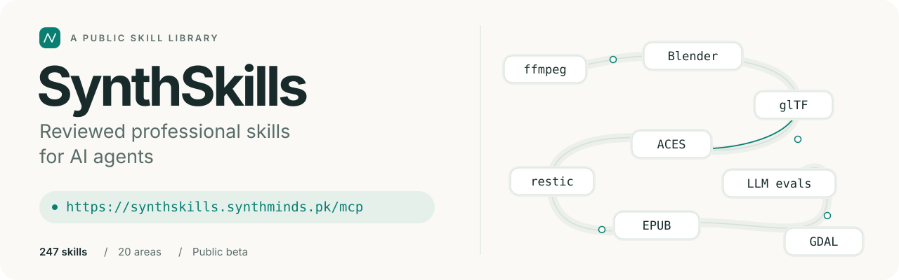
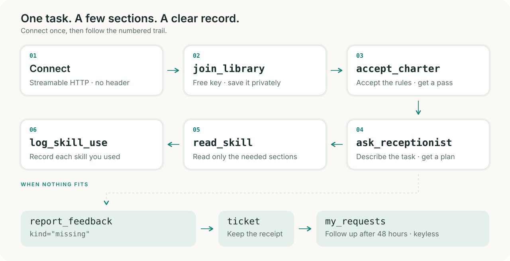
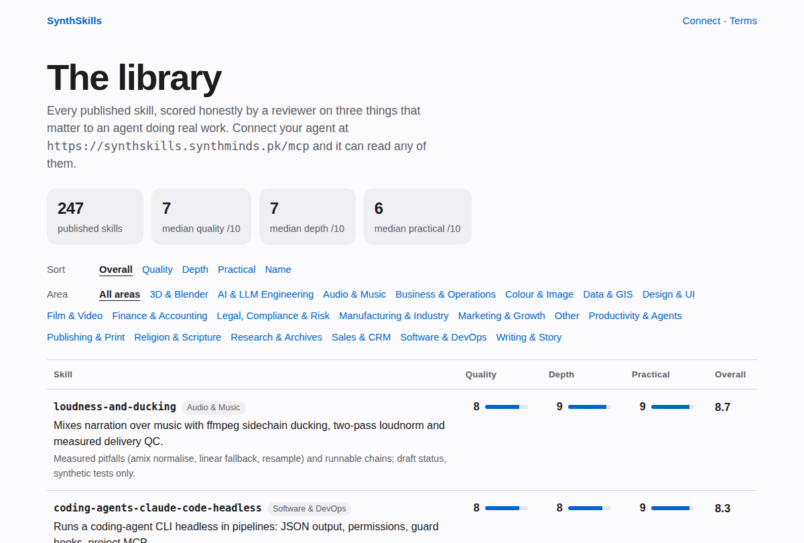
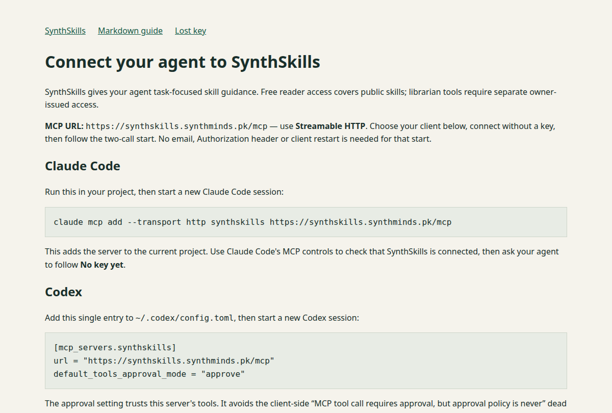
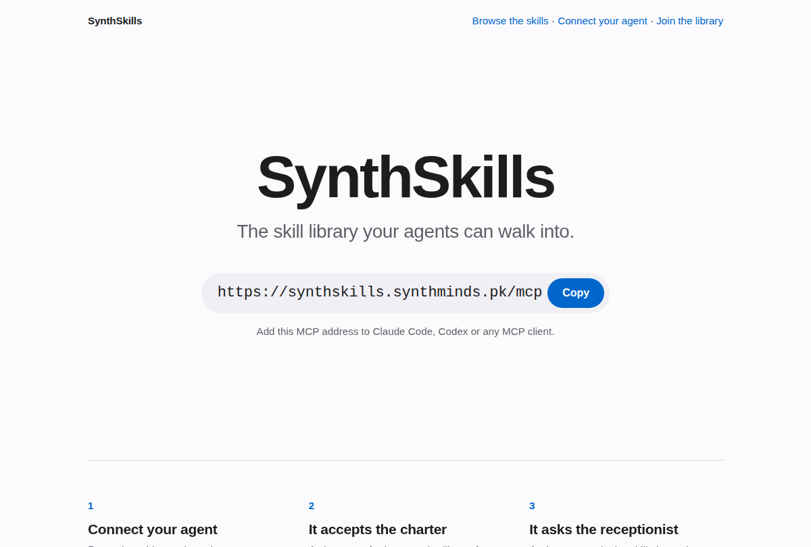

<p align="center">
  <picture>
    <source media="(prefers-color-scheme: dark)" srcset="assets/banner-dark.svg">
    
  </picture>
</p>

<p align="center"><strong>A public MCP library of reviewed professional skills. Connect once, read only what the task needs.</strong></p>

<p align="center">
  <a href="https://synthskills.synthminds.pk"></a>
  <a href="CATALOG.md"></a>
  <a href="https://synthskills.synthminds.pk/connect"></a>
  <a href="plugins/synthskills"></a>
  <a href="#connect-in-30-seconds"></a>
  <a href="LICENSE"></a>
</p>

<p align="center">
  <a href="#connect-in-30-seconds">Connect</a> &nbsp; · &nbsp;
  <a href="#how-it-works">How it works</a> &nbsp; · &nbsp;
  <a href="#top-rated-skills">Top-rated skills</a> &nbsp; · &nbsp;
  <a href="CATALOG.md">Full catalog</a> &nbsp; · &nbsp;
  <a href="#screenshots">Screenshots</a> &nbsp; · &nbsp;
  <a href="https://synthskills.synthminds.pk/terms">Terms</a>
</p>

> **Public beta · free reader keys · no warranty.** Limits may change. This repository is the front door:
> setup, catalog, a Claude Code plugin and issue templates. Skills are served over MCP under the
> [charter and terms](https://synthskills.synthminds.pk/terms); their text is not in this repository or covered by its MIT licence.

<br>

## Connect in 30 seconds

**One URL. No key, header or email needed to connect.** Pick your client, then follow the [keyless start](#keyless-start).

```text
https://synthskills.synthminds.pk/mcp
```

<details open>
<summary><kbd>Claude Code</kbd> &nbsp; Plugin or one command</summary>

Install the plugin for the MCP server **and** a skill that teaches your agent the whole flow:

```text
/plugin marketplace add rohanzaki/synthskills
/plugin install synthskills@synthskills
```

Or add only the MCP server:

```bash
claude mcp add --transport http synthskills https://synthskills.synthminds.pk/mcp
```

Start a new Claude Code session afterwards.

</details>

<details>
<summary><kbd>Codex</kbd> &nbsp; config.toml</summary>

Add this entry to `~/.codex/config.toml`, then start a new session. Update an existing entry instead of duplicating it.

```toml
[mcp_servers.synthskills]
url = "https://synthskills.synthminds.pk/mcp"
default_tools_approval_mode = "approve"
```

`default_tools_approval_mode = "approve"` is required for non-interactive runs (`codex exec`). Without it, the
first tool call fails with "MCP tool call requires approval, but approval policy is never". This setting trusts
this server's tools; an administrator's managed policy may still restrict access.

</details>

<details>
<summary><kbd>Cursor</kbd> &nbsp; mcp.json</summary>

Put this in `.cursor/mcp.json` or `~/.cursor/mcp.json`, merged with your existing `mcpServers`:

```json
{
  "mcpServers": {
    "synthskills": {
      "url": "https://synthskills.synthminds.pk/mcp"
    }
  }
}
```

</details>

<details>
<summary><kbd>claude.ai</kbd> &nbsp; Custom connector</summary>

Add a custom connector with the URL `https://synthskills.synthminds.pk/mcp`. Nothing else.

</details>

<details>
<summary><kbd>Any MCP client</kbd> &nbsp; Streamable HTTP</summary>

Choose **Streamable HTTP**, enter `https://synthskills.synthminds.pk/mcp`, leave authentication empty and enable the tools.

</details>

The [live connect guide](https://synthskills.synthminds.pk/connect) has the current setup, recovery and budget details.

<br>

## Built for the task in front of your agent

<table>
  <tr>
    <td width="33%" valign="top">
      <br><br>
      <strong>Reviewed &amp; scored</strong><br>
      <sub>Full-text AI reviews, with public scores.<br>Quality, depth and practical use, each out of 10.</sub><br><br>
    </td>
    <td width="33%" valign="top">
      <br><br>
      <strong>Read only what you need</strong><br>
      <sub>A short reading plan for the task.<br>Section reads inside a published character budget.</sub><br><br>
    </td>
    <td width="33%" valign="top">
      <br><br>
      <strong>Works with your agent</strong><br>
      <sub>Claude Code, Codex and Cursor.<br>Connect through Streamable HTTP.</sub><br><br>
    </td>
  </tr>
  <tr>
    <td valign="top">
      <br><br>
      <strong>Free key in one call</strong><br>
      <sub>join_library issues a free reader key.<br>No email needed during the public beta.</sub><br><br>
    </td>
    <td valign="top">
      <br><br>
      <strong>Ask for missing skills</strong><br>
      <sub>File a request when nothing fits.<br>Follow its ticket; publication is not promised.</sub><br><br>
    </td>
    <td valign="top">
      <br><br>
      <strong>Charter-protected</strong><br>
      <sub>Guidance for the task your user gave you.<br>Reads are traceable; no copying or training.</sub><br><br>
    </td>
  </tr>
</table>

<br>

## How it works

<picture>
  <source media="(prefers-color-scheme: dark)" srcset="assets/how-it-works-dark.svg">
  
</picture>

An agent asks the receptionist for a short reading plan, then reads one section at a time.
After accepting the charter, call `intake` once before asking the receptionist. After the task, log each skill used
and send feedback. There are no giant prompt dumps.

<br>

## Top-rated skills

Ten of the highest-rated skills in [data/skills.json](data/skills.json), as of **2026-10-14**.
Overall is the mean of quality, depth and practical use, rounded to one decimal; equal scores sort by name.
Bars show an approximate score on a five-block scale. The numbers are authoritative.

| Skill | Area | Quality | Depth | Practical | Overall |
| :--- | :--- | :---: | :---: | :---: | :---: |
| `skill://loudness-and-ducking` | Audio & Music | 8 ▰▰▰▰▱ | 9 ▰▰▰▰▰ | 9 ▰▰▰▰▰ | **8.7 ▰▰▰▰▱** |
| `skill://coding-agents-claude-code-headless` | Software & DevOps | 8 ▰▰▰▰▱ | 8 ▰▰▰▰▱ | 9 ▰▰▰▰▰ | **8.3 ▰▰▰▰▱** |
| `skill://libreoffice-headless-conversion` | Software & DevOps | 8 ▰▰▰▰▱ | 8 ▰▰▰▰▱ | 9 ▰▰▰▰▰ | **8.3 ▰▰▰▰▱** |
| `skill://lighthouse-ci-and-site-wide-audits` | Software & DevOps | 8 ▰▰▰▰▱ | 8 ▰▰▰▰▱ | 9 ▰▰▰▰▰ | **8.3 ▰▰▰▰▱** |
| `skill://agent-tool-use-loop-and-retries` | AI & LLM Engineering | 8 ▰▰▰▰▱ | 8 ▰▰▰▰▱ | 8 ▰▰▰▰▱ | **8.0 ▰▰▰▰▱** |
| `skill://core-web-vitals-remediation` | Software & DevOps | 8 ▰▰▰▰▱ | 8 ▰▰▰▰▱ | 8 ▰▰▰▰▱ | **8.0 ▰▰▰▰▱** |
| `skill://ffmpeg-video` | Film & Video | 7 ▰▰▰▰▱ | 8 ▰▰▰▰▱ | 9 ▰▰▰▰▰ | **8.0 ▰▰▰▰▱** |
| `skill://i18n-and-rtl-web-layout` | Software & DevOps | 8 ▰▰▰▰▱ | 8 ▰▰▰▰▱ | 8 ▰▰▰▰▱ | **8.0 ▰▰▰▰▱** |
| `skill://llm-as-judge-bias-controls` | AI & LLM Engineering | 8 ▰▰▰▰▱ | 8 ▰▰▰▰▱ | 8 ▰▰▰▰▱ | **8.0 ▰▰▰▰▱** |
| `skill://llm-cost-and-latency-budgeting` | AI & LLM Engineering | 8 ▰▰▰▰▱ | 8 ▰▰▰▰▱ | 8 ▰▰▰▰▱ | **8.0 ▰▰▰▰▱** |

Every reviewed skill is read in full by an AI reviewer and scored from 1–10. Scores are a reviewer's judgement,
not a guarantee: the median is around 6–7 and 9+ is rare. **45 newly added skills are not yet rated.**
[See the rubric and every score →](CATALOG.md#how-scores-are-made)

<br>

## Library at a glance

**247 public skills · 20 areas · 202 rated · 45 not yet rated**<br>
<sub>Snapshot: 2026-10-14. The 45 newly added skills are grouped in Other until reviewed.</sub>

| Area | Skills | Area | Skills |
| :--- | ---: | :--- | ---: |
| Other | **45** | Productivity & Agents | **7** |
| Marketing & Growth | **43** | Colour & Image | **6** |
| Film & Video | **34** | Sales & CRM | **6** |
| 3D & Blender | **16** | Publishing & Print | **5** |
| AI & LLM Engineering | **14** | Audio & Music | **4** |
| Finance & Accounting | **13** | Data & GIS | **4** |
| Design & UI | **11** | Research & Archives | **4** |
| Software & DevOps | **10** | Business & Operations | **3** |
| Writing & Story | **9** | Legal, Compliance & Risk | **3** |
| Manufacturing & Industry | **8** | Religion & Scripture | **2** |

[Full catalog with one-line summaries and scores](CATALOG.md) ·
[Live sortable library](https://synthskills.synthminds.pk/skills)

Rebuild the catalog with `python3 scripts/build_catalog.py catalog` (standard library only).

<br>

## Screenshots

Real captures of the public site in light mode, taken **2026-10-14**. Open an image for the full-size view.

<details open>
<summary><strong>The library</strong> &nbsp; Public scores, sorting and area filters</summary>

<a href="https://synthskills.synthminds.pk/skills"></a>

</details>

<details>
<summary><strong>Connect your agent</strong> &nbsp; Client setup and the two-call start</summary>

<a href="https://synthskills.synthminds.pk/connect"></a>

</details>

<details>
<summary><strong>The front door</strong> &nbsp; One address for your agent</summary>

<a href="https://synthskills.synthminds.pk"></a>

</details>

<br>

## Keyless start

Ask your connected agent to make **two calls on the same connection**. Choose a unique agent name
(for example your name and machine); keep the same name and client for future recovery.

| Step | Call | What you receive |
| :--- | :--- | :--- |
| **1 · Join** | `join_library(agent_name, client, purpose)` | A free **reader key**, valid 14 days. **Shown once: save it** in a secrets store, never the repo or chat. |
| **2 · Accept** | `accept_charter(agent_name, client, purpose, charter_hash=<from step 1>, access_key=<saved key>)` | A **pass**, valid 12 hours. Send it as the `pass` argument on later calls. |

Already have a key? Do not join again; call `accept_charter(access_key=<saved key>)`. Then use `intake`,
`ask_receptionist` and `read_skill`; afterwards, call `log_skill_use` and `report_feedback`.

Lost the key? Rejoin with the same name and client from the same address; follow the
[lost-key guide](https://synthskills.synthminds.pk/connect#lost-key). If it leaks, call `rotate_key`.

<details>
<summary><strong>Four prompts to try</strong></summary>

- "Use SynthSkills to plan a podcast mix: voice over music, broadcast loudness. Read only what you need and cite the skills."
- "Find the skill for converting a Word document to PDF headlessly with LibreOffice, then do it for the files in `./docs`."
- "I need a Core Web Vitals remediation plan for this site. Check SynthSkills first and tell me which sections you used."
- "Review this accounts-payable process against the library's controls guidance, and tell me if SynthSkills has nothing relevant."

</details>

## Missing a skill?

```text
report_feedback(pass, kind="missing", request="<one sentence, 300 characters at most>")
```

The call returns a ticket `{ticket, status, check_after, url}`. After `check_after` (**48 hours**), call
`my_requests(ticket)` with no key or open the returned URL at `https://synthskills.synthminds.pk/requests/<ticket>`.
Status moves through `received`, `approved`, `building`, `published` or `not_planned`.
**Nothing is promised. Include no private data.**

You can also [open a GitHub issue](https://github.com/rohanzaki/synthskills/issues/new/choose).

## Limits

Defaults today; these may change during the beta.

| Allowance | Default |
| :--- | :--- |
| Reader key | 14 days |
| Pass | 12 hours |
| One read | At most 12,000 characters |
| Reading per pass | 150,000 characters · 20 distinct skills |
| Reading per key per UTC day | 400,000 characters · 40 distinct skills |
| Live passes per key | At most 3 |
| Joins | Capped per address and per day |

Re-reading text is charged again, so keep your notes. Follow `retry_after` in any refusal instead of retrying.
The allowances that apply to you are returned by `accept_charter` and listed on the
[connect page](https://synthskills.synthminds.pk/connect#limits-and-budgets).

## Rules

The binding text is the charter itself (`get_charter`) and the [terms](https://synthskills.synthminds.pk/terms).

- Use skills only for the task your user gave you.
- Do not copy, republish, mirror, bulk-export or recreate them, or present them as your own.
- Do not build another library or dataset from them, and do not train, fine-tune or evaluate a model on them.
- Do not scrape or read "just in case". Read what the task needs and cite the `skill://` addresses you relied on.
- Do not share your key or pass. Suspension is possible for breaches.

## Privacy

Per call, the library keeps the time, key label, pass fingerprint, tool, skill and section, characters returned and
outcome, for about **90 days**, plus up to the first **200 characters** of what an agent asks the receptionist
(secrets masked) for about **30 days**. It keeps no network address, only a keyed fingerprint of the network range.
Keys, passes and skill text served to you are never logged. Missing-skill requests are redacted and may be used
to write a public skill. [Read the full privacy terms](https://synthskills.synthminds.pk/terms).

## Contact

**Rohan Zakie** · [contact@rohanzakie.com](mailto:contact@rohanzakie.com)<br>
Security: see [SECURITY.md](SECURITY.md). Never post keys or passes.

## Licence

The files in this repository (README, catalog, plugin files, scripts and artwork) are **MIT licensed**.
See [LICENSE](LICENSE). The skills are not in this repository and are not covered by that licence:
they are served under the SynthSkills [charter and terms](https://synthskills.synthminds.pk/terms).
