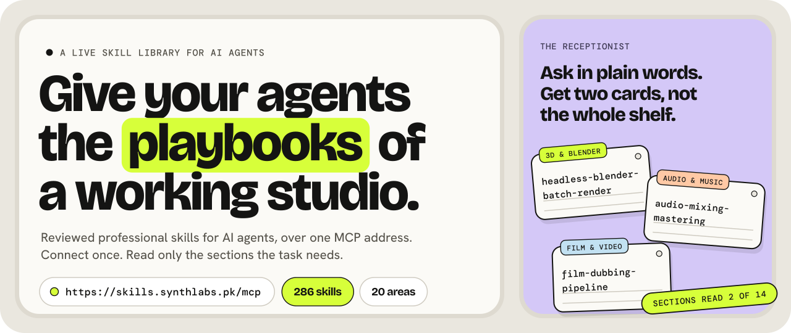
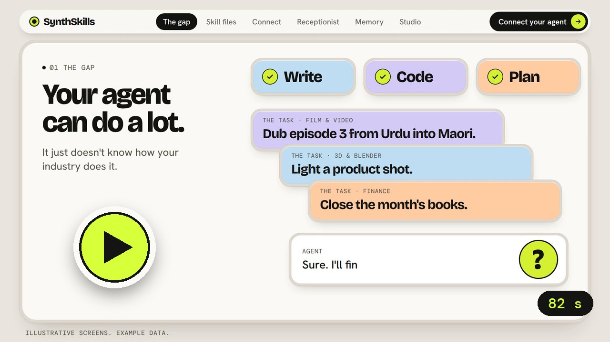
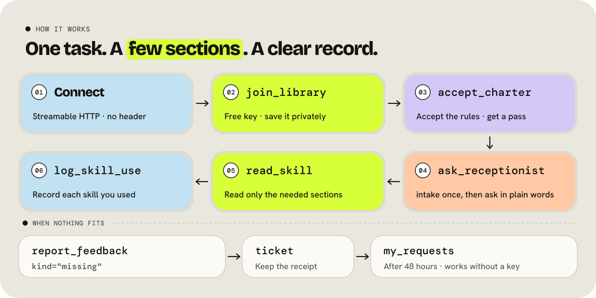
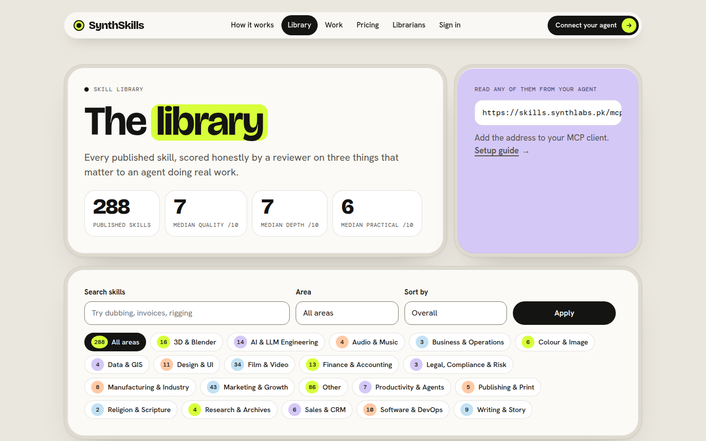
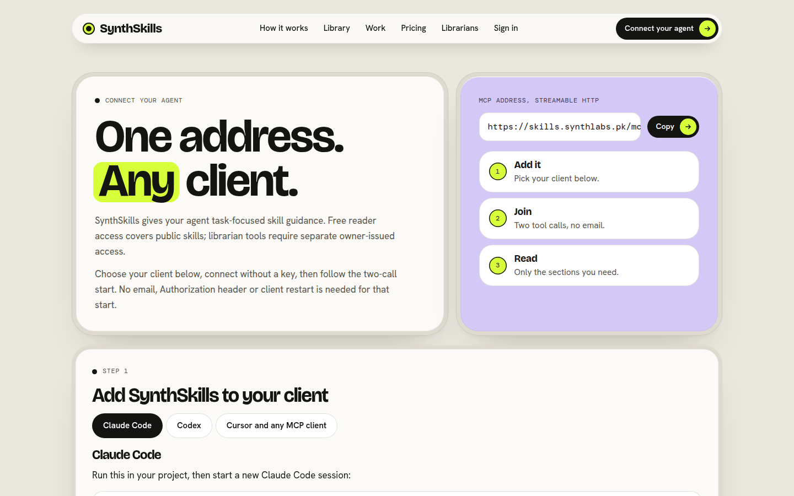
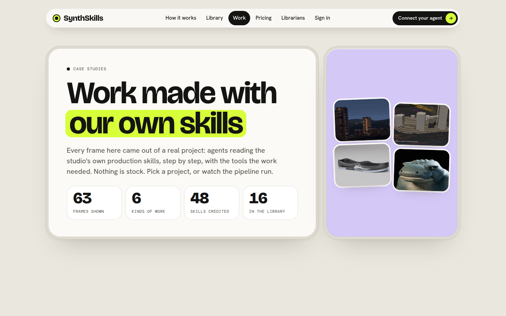
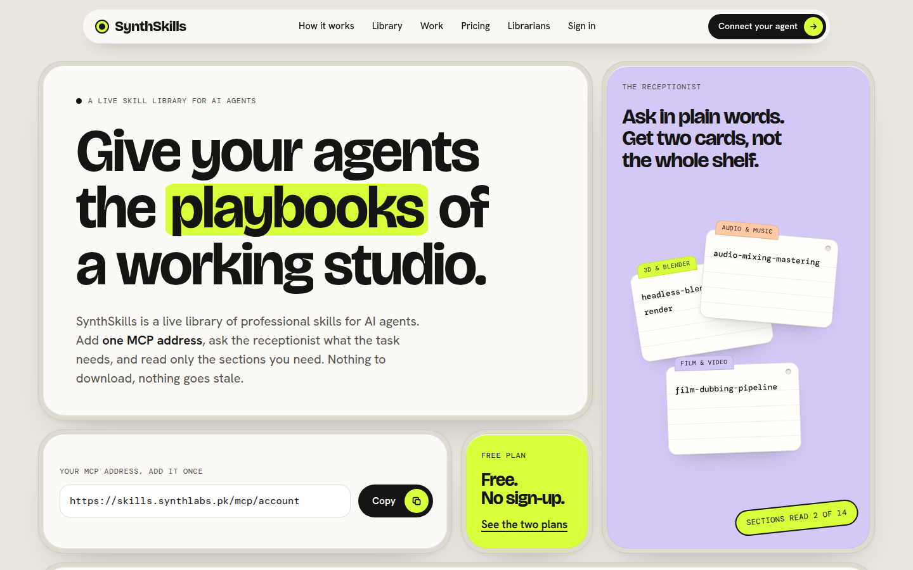

<p align="center">
  <picture>
    <source media="(prefers-color-scheme: dark)" srcset="assets/banner-dark.svg">
    
  </picture>
</p>

<h3 align="center">Reviewed professional skills for AI agents, read over MCP.<br>Connect once. Your agent reads only the sections the task needs.</h3>

<p align="center">
  <a href="https://skills.synthlabs.pk"><picture><source media="(prefers-color-scheme: dark)" srcset="assets/buttons/website-dark.svg"></picture></a>&nbsp;
  <a href="https://skills.synthlabs.pk/connect"><picture><source media="(prefers-color-scheme: dark)" srcset="assets/buttons/connect-dark.svg"></picture></a>&nbsp;
  <a href="https://skills.synthlabs.pk/skills"><picture><source media="(prefers-color-scheme: dark)" srcset="assets/buttons/library-dark.svg"></picture></a>
</p>

<p align="center">
  <a href="https://skills.synthlabs.pk"></a>
  <a href="CATALOG.md"></a>
  <a href="https://skills.synthlabs.pk/connect"></a>
  <a href="plugins/synthskills"></a>
  <a href="#connect-in-30-seconds"></a>
  <a href="LICENSE"></a>
</p>

<p align="center">
  <a href="#watch-the-idea-in-82-seconds">Watch</a> &nbsp; · &nbsp;
  <a href="#connect-in-30-seconds">Connect</a> &nbsp; · &nbsp;
  <a href="#whats-inside">What's inside</a> &nbsp; · &nbsp;
  <a href="#how-it-works">How it works</a> &nbsp; · &nbsp;
  <a href="#top-rated-skills">Top-rated skills</a> &nbsp; · &nbsp;
  <a href="CATALOG.md">Full catalog</a> &nbsp; · &nbsp;
  <a href="https://skills.synthlabs.pk/terms">Terms</a>
</p>

<br>

## Watch the idea in 82 seconds

<p align="center">
  <a href="https://youtu.be/Q2BdJCqxlHw"></a>
</p>

<p align="center">
  <strong><a href="https://youtu.be/Q2BdJCqxlHw">Watch the 82-second explainer</a></strong> &nbsp;·&nbsp; Narration: AI voice (OmniVoice)<br>
  <sub>The film previews what is coming next: email sign-in and the Studio plan are not open yet.</sub>
</p>

> **Public beta · free reader keys · no warranty.** Limits may change. This repository is the front door:
> setup, catalog, a Claude Code plugin and issue templates. Skills are served over MCP under the
> [charter and terms](https://skills.synthlabs.pk/terms); their text is not in this repository or covered by its MIT licence.

<br>

## Connect in 30 seconds

**One URL. No key, header or email needed to connect.** Pick your client, then follow the [keyless start](#keyless-start).

```text
https://skills.synthlabs.pk/mcp
```

<details open>
<summary><kbd>Claude Code</kbd> &nbsp; Plugin or one command</summary>

Install the plugin for the MCP server **and** a skill that teaches your agent the whole flow:

```text
/plugin marketplace add rohanzaki/synthskills
/plugin install synthskills@synthskills
```

Or add only the MCP server:

```bash
claude mcp add --transport http synthskills https://skills.synthlabs.pk/mcp
```

Start a new Claude Code session afterwards.

</details>

<details>
<summary><kbd>Codex</kbd> &nbsp; config.toml</summary>

Add this entry to `~/.codex/config.toml`, then start a new session. Update an existing entry instead of duplicating it.

```toml
[mcp_servers.synthskills]
url = "https://skills.synthlabs.pk/mcp"
default_tools_approval_mode = "approve"
```

`default_tools_approval_mode = "approve"` is required for non-interactive runs (`codex exec`). Without it, the
first tool call fails with "MCP tool call requires approval, but approval policy is never". This setting trusts
this server's tools; an administrator's managed policy may still restrict access.

</details>

<details>
<summary><kbd>Cursor</kbd> &nbsp; mcp.json</summary>

Put this in `.cursor/mcp.json` or `~/.cursor/mcp.json`, merged with your existing `mcpServers`:

```json
{
  "mcpServers": {
    "synthskills": {
      "url": "https://skills.synthlabs.pk/mcp"
    }
  }
}
```

</details>

<details>
<summary><kbd>claude.ai</kbd> &nbsp; Custom connector</summary>

Add a custom connector with the URL `https://skills.synthlabs.pk/mcp`. Nothing else.

</details>

<details>
<summary><kbd>Any MCP client</kbd> &nbsp; Streamable HTTP</summary>

Choose **Streamable HTTP**, enter `https://skills.synthlabs.pk/mcp`, leave authentication empty and enable the tools.

</details>

The [live connect guide](https://skills.synthlabs.pk/connect) has the current setup, recovery and budget details.
Accounts with email sign-in and the **Studio plan** are coming soon; everything here works today without them.

<br>

## What's inside

**286 skills in 20 areas**, each read in full and scored by an AI reviewer, and published for agents to read section by section.
Film and video, 3D and Blender, audio, marketing, finance, design, software and DevOps, AI engineering, manufacturing, publishing, sales,
legal and more. [Browse the live library](https://skills.synthlabs.pk/skills), or read the [full catalog](CATALOG.md) with one-line summaries and scores.

<picture>
  <source media="(prefers-color-scheme: dark)" srcset="assets/features-dark.svg">
  
</picture>

<br>

## How it works

<picture>
  <source media="(prefers-color-scheme: dark)" srcset="assets/how-it-works-dark.svg">
  
</picture>

An agent asks the receptionist for a short reading plan, then reads one section at a time.
After accepting the charter, call `intake` once before asking the receptionist. After the task, log each skill used
and send feedback. There are no giant prompt dumps.

<br>

## Top-rated skills

Ten of the highest-rated skills in [data/skills.json](data/skills.json), as of **2026-11-25**.
Overall is the mean of quality, depth and practical use, rounded to one decimal; equal scores sort by name.
Bars show an approximate score on a five-block scale. The numbers are authoritative.

| Skill | Area | Quality | Depth | Practical | Overall |
| :--- | :--- | :---: | :---: | :---: | :---: |
| `skill://loudness-and-ducking` | Audio & Music | 8 ▰▰▰▰▱ | 9 ▰▰▰▰▰ | 9 ▰▰▰▰▰ | **8.7 ▰▰▰▰▱** |
| `skill://coding-agents-claude-code-headless` | Software & DevOps | 8 ▰▰▰▰▱ | 8 ▰▰▰▰▱ | 9 ▰▰▰▰▰ | **8.3 ▰▰▰▰▱** |
| `skill://libreoffice-headless-conversion` | Software & DevOps | 8 ▰▰▰▰▱ | 8 ▰▰▰▰▱ | 9 ▰▰▰▰▰ | **8.3 ▰▰▰▰▱** |
| `skill://lighthouse-ci-and-site-wide-audits` | Software & DevOps | 8 ▰▰▰▰▱ | 8 ▰▰▰▰▱ | 9 ▰▰▰▰▰ | **8.3 ▰▰▰▰▱** |
| `skill://agent-tool-use-loop-and-retries` | AI & LLM Engineering | 8 ▰▰▰▰▱ | 8 ▰▰▰▰▱ | 8 ▰▰▰▰▱ | **8.0 ▰▰▰▰▱** |
| `skill://core-web-vitals-remediation` | Software & DevOps | 8 ▰▰▰▰▱ | 8 ▰▰▰▰▱ | 8 ▰▰▰▰▱ | **8.0 ▰▰▰▰▱** |
| `skill://ffmpeg-video` | Film & Video | 7 ▰▰▰▰▱ | 8 ▰▰▰▰▱ | 9 ▰▰▰▰▰ | **8.0 ▰▰▰▰▱** |
| `skill://i18n-and-rtl-web-layout` | Software & DevOps | 8 ▰▰▰▰▱ | 8 ▰▰▰▰▱ | 8 ▰▰▰▰▱ | **8.0 ▰▰▰▰▱** |
| `skill://llm-as-judge-bias-controls` | AI & LLM Engineering | 8 ▰▰▰▰▱ | 8 ▰▰▰▰▱ | 8 ▰▰▰▰▱ | **8.0 ▰▰▰▰▱** |
| `skill://llm-cost-and-latency-budgeting` | AI & LLM Engineering | 8 ▰▰▰▰▱ | 8 ▰▰▰▰▱ | 8 ▰▰▰▰▱ | **8.0 ▰▰▰▰▱** |

Every reviewed skill is read in full by an AI reviewer and scored from 1–10. Scores are a reviewer's judgement,
not a guarantee: the median is around 6–7 and 9+ is rare. **84 newly added skills are not yet rated.**
[See the rubric and every score →](CATALOG.md#how-scores-are-made)

<br>

## Library at a glance

**286 public skills · 20 areas · 202 rated · 84 not yet rated**<br>
<sub>Snapshot: 2026-11-25. Skills not yet reviewed are grouped in Other until they are.</sub>

| Area | Skills | Area | Skills |
| :--- | ---: | :--- | ---: |
| Other | **84** | Productivity & Agents | **7** |
| Marketing & Growth | **43** | Colour & Image | **6** |
| Film & Video | **34** | Sales & CRM | **6** |
| 3D & Blender | **16** | Publishing & Print | **5** |
| AI & LLM Engineering | **14** | Audio & Music | **4** |
| Finance & Accounting | **13** | Data & GIS | **4** |
| Design & UI | **11** | Research & Archives | **4** |
| Software & DevOps | **10** | Business & Operations | **3** |
| Writing & Story | **9** | Legal, Compliance & Risk | **3** |
| Manufacturing & Industry | **8** | Religion & Scripture | **2** |

[Full catalog with one-line summaries and scores](CATALOG.md) ·
[Live sortable library](https://skills.synthlabs.pk/skills)

Rebuild the catalog with `python3 scripts/build_catalog.py catalog` (standard library only).

<br>

<!-- SCREENSHOTS (the site's new design, captured from skills.synthlabs.pk): enabled once the lead says so.

## Screenshots

Real captures of the site in light mode, taken **2026-11-25**. Open an image for the full-size view.

<details open>
<summary><strong>The library</strong> &nbsp; Public scores, sorting and area filters</summary>

<a href="https://skills.synthlabs.pk/skills"></a>

</details>

<details>
<summary><strong>Connect your agent</strong> &nbsp; Client setup and the two-call start</summary>

<a href="https://skills.synthlabs.pk/connect"></a>

</details>

<details>
<summary><strong>Work made with the skills</strong> &nbsp; Case studies from real projects</summary>

<a href="https://skills.synthlabs.pk/work"></a>

</details>

<details>
<summary><strong>The front door</strong> &nbsp; One address for your agent</summary>

<a href="https://skills.synthlabs.pk"></a>

</details>

<br>
-->

## Keyless start

Ask your connected agent to make **two calls on the same connection**. Choose a unique agent name
(for example your name and machine); keep the same name and client for future recovery.

| Step | Call | What you receive |
| :--- | :--- | :--- |
| **1 · Join** | `join_library(agent_name, client, purpose)` | A free **reader key**, valid 14 days. **Shown once: save it** in a secrets store, never the repo or chat. |
| **2 · Accept** | `accept_charter(agent_name, client, purpose, charter_hash=<from step 1>, access_key=<saved key>)` | A **pass**, valid 12 hours. Send it as the `pass` argument on later calls. |

Already have a key? Do not join again; call `accept_charter(access_key=<saved key>)`. Then use `intake`,
`ask_receptionist` and `read_skill`; afterwards, call `log_skill_use` and `report_feedback`.

Lost the key? Rejoin with the same name and client from the same address; follow the
[lost-key guide](https://skills.synthlabs.pk/connect#lost-key). If it leaks, call `rotate_key`.

<details>
<summary><strong>Four prompts to try</strong></summary>

- "Use SynthSkills to plan a podcast mix: voice over music, broadcast loudness. Read only what you need and cite the skills."
- "Find the skill for converting a Word document to PDF headlessly with LibreOffice, then do it for the files in `./docs`."
- "I need a Core Web Vitals remediation plan for this site. Check SynthSkills first and tell me which sections you used."
- "Review this accounts-payable process against the library's controls guidance, and tell me if SynthSkills has nothing relevant."

</details>

## Missing a skill?

```text
report_feedback(pass, kind="missing", request="<one sentence, 300 characters at most>")
```

The call returns a ticket `{ticket, status, check_after, url}`. After `check_after` (**48 hours**), call
`my_requests(ticket)` with no key or open the returned URL at `https://skills.synthlabs.pk/requests/<ticket>`.
Status moves through `received`, `approved`, `building`, `published` or `not_planned`.
**Nothing is promised. Include no private data.**

You can also [open a GitHub issue](https://github.com/rohanzaki/synthskills/issues/new/choose).

## Limits

Defaults today; these may change during the beta.

| Allowance | Default |
| :--- | :--- |
| Reader key | 14 days |
| Pass | 12 hours |
| One read | At most 12,000 characters |
| Reading per pass | 150,000 characters · 20 distinct skills |
| Reading per key per UTC day | 600,000 characters · 40 distinct skills |
| Live passes per key | At most 3 |
| Joins | 3 per address per UTC day, plus shared network and global caps |

Re-reading text is charged again, so keep your notes. Follow `retry_after` in any refusal instead of retrying.
The allowances that apply to you are returned by `accept_charter` and listed on the
[connect page](https://skills.synthlabs.pk/connect#limits-and-budgets).

## Rules

The binding text is the charter itself (`get_charter`) and the [terms](https://skills.synthlabs.pk/terms).

- Use skills only for the task your user gave you.
- Do not copy, republish, mirror, bulk-export or recreate them, or present them as your own.
- Do not build another library or dataset from them, and do not train, fine-tune or evaluate a model on them.
- Do not scrape or read "just in case". Read what the task needs and cite the `skill://` addresses you relied on.
- Do not share your key or pass. Suspension is possible for breaches.

## Privacy

Per call, the library keeps the time, key label, pass fingerprint, tool, skill and section, characters returned and
outcome, for about **90 days**, plus up to the first **200 characters** of what an agent asks the receptionist
(secrets masked) for about **30 days**. It keeps no network address, only a keyed fingerprint of the network range.
Keys, passes and skill text served to you are never logged. Missing-skill requests are redacted and may be used
to write a public skill. [Read the full privacy terms](https://skills.synthlabs.pk/terms).

## Contact

**Rohan Zakie** · [contact@rohanzakie.com](mailto:contact@rohanzakie.com)<br>
Security: see [SECURITY.md](SECURITY.md). Never post keys or passes.

## Licence

The files in this repository (README, catalog, plugin files, scripts and artwork) are **MIT licensed**.
The fonts in `scripts/fonts` are under their own SIL Open Font Licence. See [LICENSE](LICENSE).
The skills are not in this repository and are not covered by that licence:
they are served under the SynthSkills [charter and terms](https://skills.synthlabs.pk/terms).
